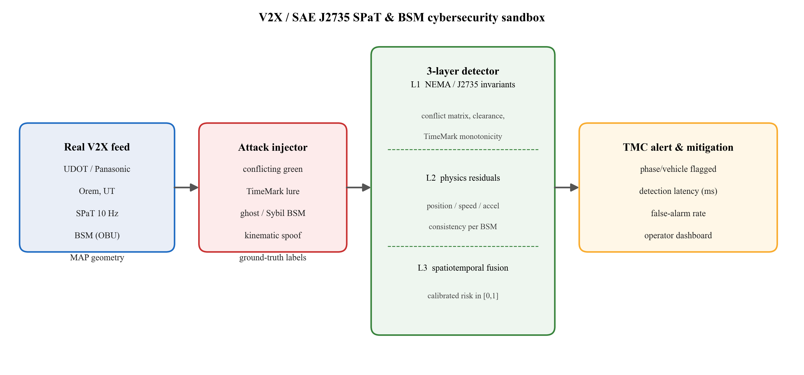
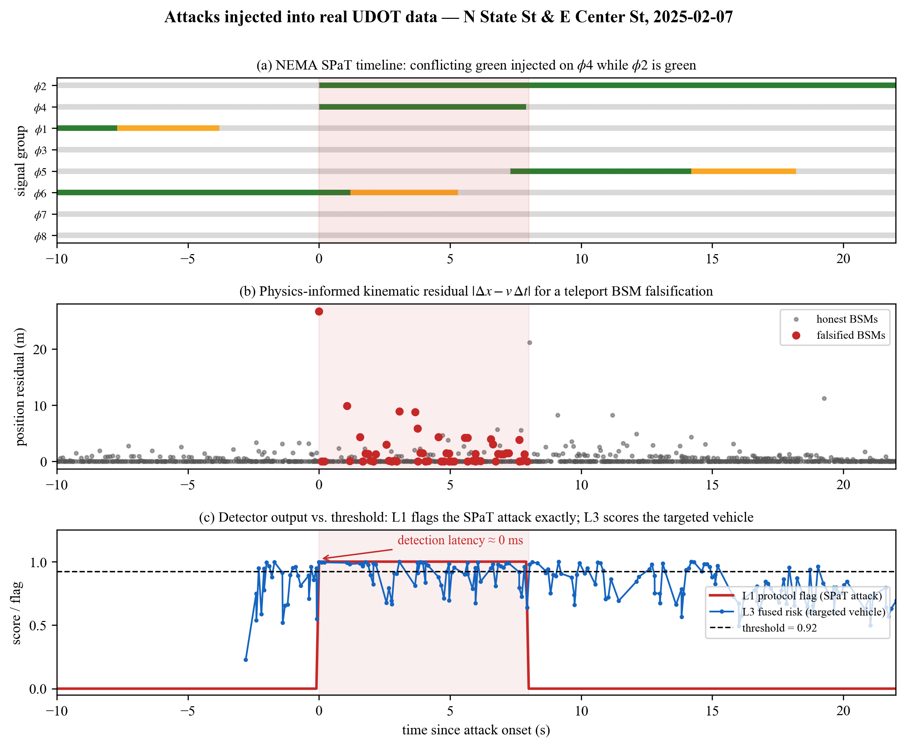

# v2x-j2735-cyber-sandbox

**A replay-and-detection sandbox for V2X / SAE J2735 cyberattacks, built on real connected-vehicle data.**

Real SPaT (signal phase and timing) and BSM (basic safety message) streams from a live deployment are replayed,
cyberattacks are injected with ground-truth labels, and a three-layer physics-informed detector is scored
against them. Everything honest in the data is real: the signal timing, the vehicle trajectories, the GNSS
noise. Only the attacks are synthetic, and they are spliced into the real messages so the detector is tested
against genuine traffic rather than a simulator.



## Why

Most intrusion-detection work for connected vehicles is evaluated on simulated BSMs (VeReMi, SUMO) and on SPaT
that never violates the controller's own logic. Real deployments behave differently: equipped-vehicle
penetration is low and bursty, GPS noise is heavy-tailed, and real NEMA controllers routinely do things a naive
checker would call anomalies (force a phase off without a yellow, overrun an advertised `minEndTime`). A
detector that reports zero false positives on a simulator can drown an operator in alarms on real data. This
sandbox evaluates the detector where it will actually run.

## Data

Real data from the **Utah DOT / Panasonic Connected Vehicle Data Ecosystem Program** (Orem, UT), published on
the USDOT ITS DataHub:

| Message | Dataset | Notes |
|---|---|---|
| SPaT | [`iq8k-ytf6`](https://data.transportation.gov/d/iq8k-ytf6) | 10 Hz J2735 SPaT, 8 signal groups, `minEndTime`/`maxEndTime` |
| BSM | [`ev64-jn8c`](https://data.transportation.gov/d/ev64-jn8c) | deduplicated BSMs heard by the RSUs |
| MAP | [`aj9z-iw7k`](https://data.transportation.gov/d/aj9z-iw7k) | lane geometry, signal-group connections |

The default intersection is **6311 — N State St & E Center St**, a standard 8-phase dual-ring NEMA TS2
intersection. `scripts/download_data.py` fetches one day; a 15-minute real slice is committed under
`tests/fixtures/` so the tests run without any download.

```bash
python scripts/download_data.py --intersection 6311 --date 2025-02-07
```

## Attacks

Injected into the real streams, each with per-message ground-truth labels:

1. **Conflicting-green SPaT spoofing** — a compromised RSU rebroadcasts SPaT with a phase conflicting with the
   current green set to `protected-Movement-Allowed` (`conflict`), or releases a conflicting phase before the
   real red clearance has elapsed (`clearance`).
2. **TimeMark / green-extension spoofing** — during a real green approaching its end, the advertised
   `minEndTime` is pushed several seconds past the real switch (and past `maxEndTime`), the lure that keeps a
   connected vehicle accelerating toward a red.
3. **Ghost queue / Sybil BSM injection** — forged stationary BSMs (Sybil IDs, plausible GNSS noise and sizes)
   are injected at a real approach's stop bar to fake a standing queue or actuation demand.
4. **Kinematic BSM falsification** — a real moving vehicle's own BSMs are falsified: `speed_spoof` (constant
   speed offset), `fake_brake` (reported hard braking with no matching motion), or `teleport` (position jumped
   downstream).

## Detector

Three layers, in `src/detector.py` and `src/nema_controller.py`:

* **Layer 1 — NEMA / J2735 protocol invariants.** A ring-and-barrier state machine checks the SPaT stream
  message by message: the phase conflict matrix, legal interval transitions, red-clearance timing, and
  `minEndTime`/`maxEndTime` monotonicity. The enabled check set is calibrated on clean real data to raise
  **zero** false positives; invariants that honest controllers legitimately break are documented and left off
  by default.
* **Layer 2 — physics-informed kinematic residuals.** Per BSM, computed from consecutive messages of the same
  sender: position residual against a constant-velocity prediction, implied acceleration and jerk, a
  reported-vs-displacement speed consistency (single-step and windowed), and reported-vs-implied acceleration
  agreement. Each becomes a one-sided z-score against robust clean-data scale.
* **Layer 3 — lightweight spatiotemporal fusion.** The residuals, context features (distance to stop bar, the
  signal shown to the vehicle, speed relative to lane neighbours, local sender density) and the Layer-1 flag
  are fused by a logistic model (numpy; uses torch when installed) into a calibrated `[0, 1]` risk per BSM. The
  operating threshold is set on a clean validation split at a target false-alarm rate.

## Results

Trained and evaluated with a **leak-free time split** (earliest hours train, next validate, rest test; attacks
injected at different clock times and into different real traffic than training). See `results/RESULTS.md` for
the full table; headline numbers below.

Intersection 6311, 2025-02-07, leak-free time split, 5 seeds (mean ± SD):

| Attack | Detector | Scenarios | Detection rate | Msg recall | PR-AUC | Median latency |
|---|---|--:|--:|--:|--:|--:|
| Conflicting-green SPaT spoofing | L1 protocol | 100 | 1.00 ± 0.00 | 1.00 ± 0.01 | 0.997 ± 0.005 | 0 ms |
| TimeMark / green-extension spoofing | L1 protocol | 50 | 1.00 ± 0.00 | 1.00 ± 0.00 | 0.998 ± 0.002 | 0 ms |
| Ghost queue / Sybil BSM injection | L3 fused | 50 | 1.00 ± 0.00 | 0.99 ± 0.00 | 0.894 ± 0.013 | 170 ms |
| Kinematic BSM falsification | L3 fused | 150 | 0.97 ± 0.01 | 0.43 ± 0.02 | 0.080 ± 0.006 | 0 ms |

False alarms on untouched real data: **Layer-1 protocol false positives 0 / 287,755 SPaT messages**; Layer-3
BSM false-positive rate **3.45 ± 0.14 %** (7.0 ± 0.3 alarms per vehicle-hour) at an operating point calibrated
to 1 % on a held-out clean split — the gap between the calibrated and realised rate is itself a finding: a
threshold set on one clean window does not transfer perfectly to another, which a simulator would hide.



**What the numbers say.** Protocol-layer attacks (conflicting green, TimeMark) are caught deterministically at
the first tampered message with zero false positives, because they violate invariants that honest real data
never does. Ghost-queue injection is caught by the spatiotemporal layer (a dense static cluster at a stop bar
is unlike anything in the honest data). Kinematic falsification is the hard case: a **constant** position or
speed offset is nearly invisible between two consecutive messages once the vehicle is mid-attack — it shows up
only at the onset/offset edges and through the windowed consistency feature — which is why its per-message
recall is far below its attack-level detection rate. This mirrors the known difficulty of constant-offset
attacks in the VeReMi literature, now reproduced on real data.

## Quickstart

```bash
python -m venv .venv && .venv/Scripts/activate      # Windows; use source .venv/bin/activate on Linux/Mac
pip install -r requirements.txt
pytest                                               # 10 tests on the committed real fixture
streamlit run app.py                                 # interactive replay dashboard
```

Reproduce the benchmark and figures (after downloading a day):

```bash
python -m src.cli run --data data/raw --out results --seeds 5   # train + evaluate, writes results/RESULTS.md
python scripts/generate_figures.py --data data/raw              # 300-DPI figures in docs/figures/
```

## Interactive dashboard (`app.py`)

* **Control sidebar** — attack, variant, replay window, attack onset, detector sensitivity.
* **Panel A** — live NEMA TS2 dual-ring and barrier diagram; flashes a CONFLICT / PROTOCOL VIOLATION banner
  when a spoofed SPaT breaks the conflict matrix.
* **Panel B** — approach time-space diagram (distance to stop bar vs. time), highlighting falsified and ghost
  BSMs.
* **Panel C** — kinematic residual, protocol-violation count and fused anomaly risk vs. threshold, with
  detection-latency, recall and false-alarm KPI cards.
* **Panel D** — raw J2735 packet inspector diffing the spoofed message against the genuine one.

## Layout

```
src/j2735_models.py      SPaT / BSM / MAP parsing, J2735 units, lane geometry and map matching
src/nema_controller.py   NEMA TS2 conflict matrix, timing estimation, ring-and-barrier monitor (Layer 1)
src/data_loader.py       load real SPaT/BSM/MAP into tidy tables
src/scenario_generator.py  inject the four attack families into real streams, with labels
src/detector.py          Layer 2 physics residuals + Layer 3 fusion
src/experiment.py        leak-free split, training, metrics
src/report.py, cli.py    aggregate results; command line
app.py                   Streamlit dashboard
scripts/                 download_data.py, generate_figures.py
tests/                   pytest suite on a committed 15-minute real fixture
```

## Limitations

One intersection and one day by default; low equipped-vehicle penetration limits the number of distinct
kinematic test cases per window (the benchmark runs on a bounded daytime window for this reason). The attacks
are injected rather than captured from a real adversary, and the Layer-3 model is deliberately lightweight. The
honest finding — that constant-offset BSM falsification is hard to catch per-message even on real data — is a
result, not a bug.

## License

MIT. The underlying data is public and credited to UDOT / Panasonic via the USDOT ITS DataHub.
