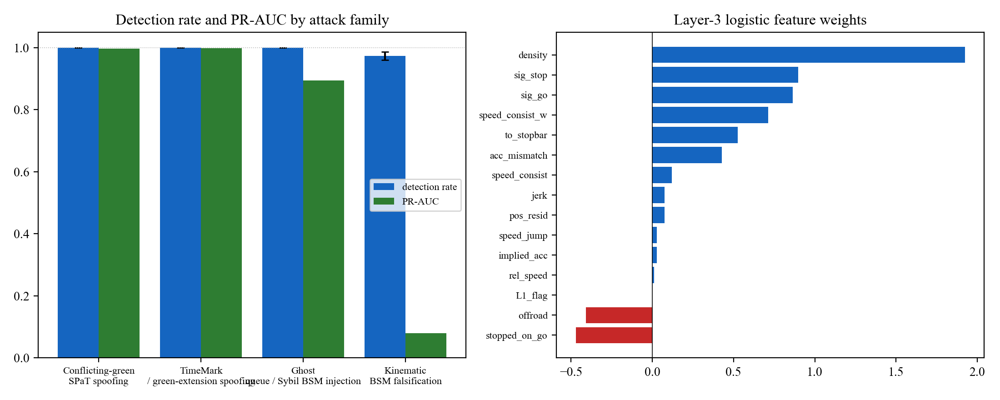

# Benchmark results

Real connected-vehicle data: UDOT / Panasonic SPaT and BSM, intersection 6311 (2025-02-07), leak-free time split (train 1.6 h, test 1.6 h), 5 seeds. Mean ± SD across seeds.

## Detection by attack family

| Attack | Detector | Scenarios | Detection rate | Msg recall | PR-AUC | Median latency (ms) |
|---|---|--:|--:|--:|--:|--:|
| Conflicting-green SPaT spoofing | L1 protocol | 100 | 1.00 ± 0.00 | 1.00 ± 0.01 | 0.997 ± 0.005 | 0 ± 0 |
| TimeMark / green-extension spoofing | L1 protocol | 50 | 1.00 ± 0.00 | 1.00 ± 0.00 | 0.998 ± 0.002 | 0 ± 0 |
| Ghost queue / Sybil BSM injection | L3 fused | 50 | 1.00 ± 0.00 | 0.99 ± 0.00 | 0.894 ± 0.013 | 170 ± 87 |
| Kinematic BSM falsification | L3 fused | 150 | 0.97 ± 0.01 | 0.43 ± 0.02 | 0.080 ± 0.006 | 0 ± 0 |

## False alarms on untouched real data

* BSM false-positive rate: **3.45 ± 0.14 %** (operating point calibrated to 1 % on a held-out clean split).
* Alarms per vehicle-hour: **7.0 ± 0.3**.
* Layer-1 protocol false positives: **0 / 287,755** SPaT messages.

## Learned Layer-3 feature weights (mean across seeds)

| Feature | Weight |
|---|--:|
| density | +1.92 |
| sig_stop | +0.90 |
| sig_go | +0.87 |
| speed_consist_w | +0.71 |
| to_stopbar | +0.53 |
| stopped_on_go | -0.47 |
| acc_mismatch | +0.43 |
| offroad | -0.41 |
| speed_consist | +0.12 |
| jerk | +0.08 |
| pos_resid | +0.07 |
| implied_acc | +0.03 |
| speed_jump | +0.03 |
| rel_speed | +0.01 |
| L1_flag | +0.00 |

